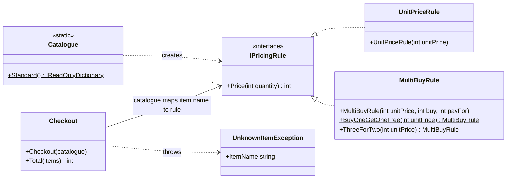

# Shopping Basket

A small C# library that prices a basket of shopping, with a console front end and an xUnit test suite. Built for the Delta Capita technical test.

> Items are presented one at a time, in a list, identified by name. Apples are 35p, bananas 20p, melons 50p (buy one get one free) and limes 15p (three for the price of two). Given a list of shopping, calculate the total cost.

## Quick start

Requires the [.NET 10 SDK](https://dotnet.microsoft.com/download/dotnet/10.0) (current LTS).

```bash
dotnet build
dotnet test
dotnet run --project src/ShoppingBasket.Console -- Apple Apple Banana
# Total: £0.90
```

| Command | Output | Exit code |
|---|---|---|
| `dotnet run --project src/ShoppingBasket.Console -- Apple Apple Banana` | `Total: £0.90` | 0 |
| `dotnet run --project src/ShoppingBasket.Console -- Melon Melon Melon Lime Lime Lime Lime` | `Total: £1.45` | 0 |
| `dotnet run --project src/ShoppingBasket.Console` | `Total: £0.00` | 0 |
| `dotnet run --project src/ShoppingBasket.Console -- Apple Pear` | `Unknown item 'Pear'. Item names are case-sensitive.` (stderr) | 1 |

## Project layout

```
ShoppingBasket.sln
├── src/ShoppingBasket/             Class library: all pricing logic
│   ├── Checkout.cs                 Totals a basket using an injected catalogue
│   ├── IPricingRule.cs             Contract: price N units of one item
│   ├── UnitPriceRule.cs            No offer, N × unit price
│   ├── MultiBuyRule.cs             "Buy N, pay for M" (BOGOF, 3 for 2)
│   ├── Catalogue.cs                The prices and offers from the brief
│   └── UnknownItemException.cs
├── src/ShoppingBasket.Console/     Thin CLI: args in, total out
└── tests/ShoppingBasket.Tests/     xUnit tests
```

## Design



`catalogue` is an `IReadOnlyDictionary<string, IPricingRule>` (item name → rule) and `items` is an `IEnumerable<string>`. Totals are in pence.

**How a total is calculated**

1. `Checkout.Total` counts the basket, e.g. `["Apple", "Banana", "Apple"]` becomes `{Apple: 2, Banana: 1}`.
2. For each distinct item it looks up that item's `IPricingRule` in the catalogue and calls `Price(count)`.
3. The line prices are summed.

`Checkout` only counts items and looks up rules. It knows nothing about prices or offers. Each rule knows how to price any number of one item, and nothing about baskets.

**The offer formula.** For "buy `b`, pay for `p`" with quantity `q`, the customer pays for `(q / b) × p + q % b` units (integer division). Three limes give 1 complete group, so 2 paid units and 30p. Four limes give 1 group plus 1 leftover, so 3 paid units and 45p.

## Key decisions

| Decision | Why |
|---|---|
| **Money is `int` pence** | Integer arithmetic is exact, with no `0.1 + 0.2` rounding errors. All prices in the brief are whole pence. Pence are converted to pounds only for display, at the console edge, using `decimal`. The library is compiled with checked arithmetic, so an overflow throws `OverflowException` instead of silently wrapping to a wrong price. |
| **One `IPricingRule` per item (strategy pattern)** | Offers are the part most likely to change. Each one is a small class you can test on its own. A new offer (e.g. "2 for £1") is a new class, and `Checkout` never changes (open/closed principle). |
| **One `MultiBuyRule` for BOGOF and 3-for-2** | Both offers are "buy N, pay for M", so one implementation covers both instead of two near-copies. The named factories `BuyOneGetOneFree` and `ThreeForTwo` keep the catalogue readable, and invalid offers (e.g. buy 2 pay for 2) are rejected when the rule is built. |
| **Catalogue injected into `Checkout`** | Prices are data, not logic. Tests and other callers can supply any catalogue (see `Uses_the_injected_catalogue`). Prices could come from a file, a database or a different store without touching the calculator. `Catalogue.Standard()` is only the brief's data, kept in one place. |
| **Count first, then price** | Totals are independent of item order by construction, and each rule is called once per item type rather than once per unit. |
| **Defensive copy of the catalogue** | `Checkout` copies the dictionary with an ordinal comparer. Matching is always exact, whatever comparer the caller used, and later changes to the caller's dictionary cannot change prices mid-checkout. |
| **Specific exception for unknown items** | `UnknownItemException` carries `ItemName` and says what went wrong. A silent zero price would under-charge customers. |
| **Thin console app** | All behaviour lives in the library and is unit-tested. The console only parses arguments, formats output and maps errors to an exit code. |

## Assumptions

- **Unknown items** are an error. The whole basket is rejected with `UnknownItemException`, and no partial total is returned.
- **Item names are case-sensitive** and must match exactly: `Apple` is valid, `apple` and `APPLE` are unknown items. The brief gives names in a fixed form ("Apple", "Banana"), and exact matching avoids guessing about culture-specific casing. Making matching case-insensitive would be a one-line change in `Checkout` (`StringComparer.OrdinalIgnoreCase`).
- Names are **singular** ("Apple", not "Apples"), as in the brief's example list.
- **Offers apply per item type** and can be used repeatedly: 4 melons cost 2 × 50p, 6 limes cost 4 × 15p. Offers do not combine across different items.
- **An empty basket** costs £0.00 and is not an error.
- **Output format:** the console prints `Total: £X.XX` using invariant formatting. The library always returns pence, so formatting is left to the caller.

## Test strategy

Tests go through the public API only, so the internals can be refactored freely. `[Theory]` with `[InlineData]` is used wherever the same behaviour is checked with different data, which keeps each case to one line. Rules are also tested on their own with a non-spec offer (buy 5 pay for 3), to show the formula is general and not tuned to 2-for-1 and 3-for-2.

39 test cases, all passing:

| Area | Cases | Expected |
|---|---|---|
| Empty basket | `[]` | 0p |
| Single item | Apple / Banana / Melon / Lime | 35 / 20 / 50 / 15p |
| Melon BOGOF | 1, 2, 3, 4 melons | 50, 50, 100, 100p |
| Lime 3-for-2 | 1, 2, 3, 4, 5, 6 limes | 15, 30, 30, 45, 60, 60p |
| Spec example | `Apple, Apple, Banana` | 90p |
| Mixed basket | 2 Apple, 1 Banana, 3 Melon, 4 Lime, interleaved | 235p |
| Order independence | Same 6 items in 3 different orders | 115p each |
| Unknown item | `Pear`, `apple` (wrong case), `""` | `UnknownItemException` with `ItemName` |
| Injected catalogue | Custom catalogue with only `Pear` at 3-for-2 | 80p; `Apple` is unknown |
| Null input | `null` catalogue or `null` items | `ArgumentNullException` |
| `UnitPriceRule` | 0, 1, 3 units at 35p | 0, 35, 105p |
| `MultiBuyRule` (buy 5 pay 3, 10p) | 0, 4, 5, 7, 10 units | 0, 40, 30, 50, 60p |
| Invalid offers | negative price, pay for 0, buy ≤ pay for | `ArgumentOutOfRangeException` |
| Negative input | negative unit price or quantity | `ArgumentOutOfRangeException` |
| Overflow | `int.MaxValue` apples | `OverflowException` |

Run a single area with e.g. `dotnet test --filter "FullyQualifiedName~Melons"`.

## Possible extensions

All of these fit the current design without changing `Checkout`, except the first:

- **Offers across different items** (e.g. "any 3 fruits for £1", or meal deals). Per-item rules can't express these. The next step would be basket-level rules that run after the per-item lines, each returning a discount, for example `IBasketDiscount.Apply(IReadOnlyDictionary<string, int> counts)`. Overlapping offers would then need a precedence policy.
- **Catalogue from config:** load prices and offers from JSON, e.g. `{ "Lime": { "price": 15, "offer": { "buy": 3, "payFor": 2 } } }`, and map each entry to a rule. Prices could then change without a release.
- **New offer types:** "N for a fixed price" (e.g. 2 for 25p), or percentage off. Each is one new `IPricingRule` class.
- **Itemised receipt:** return line items (item, quantity, price, saving) rather than only the total.
- **Money type:** a `Money` value object with currency if more than one currency is needed. `int` pence is enough for one currency.
- **Case-insensitive or alias matching** if inputs come from free-text entry.
